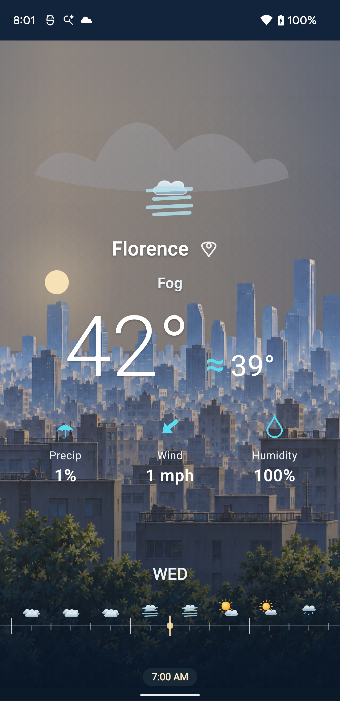

# P.2.26 — Long-tick labels UI artwork board

**Review state:** Product owner approved as shown on 2026-11-11.

## Visual objective

Give the hourly axis a readable time anchor every three hours by labeling every existing longest tick. Place each label below its tick. Write noon and midnight as `12 PM` and `12 AM` so the repeated 12-hour numeral is clear.

## Actual device capture

The board uses a fresh screen capture from the connected Pixel 3 XL (`8AKY0M32X`) in hourly mode. It shows `WED` above the weather-symbol row, the selected `7:00 AM` readout at the bottom, and the real tick lengths. The board overlays `3`, `6`, and `9` under every longest tick visible in this viewport. The raw capture is preserved alongside the board and contains no added labels.

## Proposed appearance

See the companion SVG/PNG board for the actual device capture with `3`, `6`, and `9` overlaid below their longest ticks, plus an enlarged crop of the same screen. The selected `7:00 AM` screenshot shows three adjacent long-tick labels in an eight-hour window. The board's midnight state uses `12 AM`; a noon long tick uses `12 PM`.

- Place each number below and centered on every visible longest tick, after the tick's lower end.
- Keep the current longest-tick cadence of every three local hours; leave intervening whole-hour and half-hour ticks blank.
- Distinguish the two 12-hour marks with `12 AM` at midnight and `12 PM` at noon.
- Preserve the 48 dp/hour scale, 24 dp symbols at their established `:30` centers, `WED` placement, playhead, exact focused-time pill, scene, forecast readout, gestures, and daily mode.

## Review boundary

This board governs only label placement and the long-tick cadence on the active-catalog and fixture/debug hourly timelines, including scrubbing and noon/midnight. It does not authorize changes to tick cadence, scale, icon mapping or positions, daily timeline, readout, or surrounding scene. The actual device screenshot is board context, not installed acceptance evidence. Slice acceptance still requires installed captures and focused interactions on both timeline surfaces, plus an unchanged daily reference.
