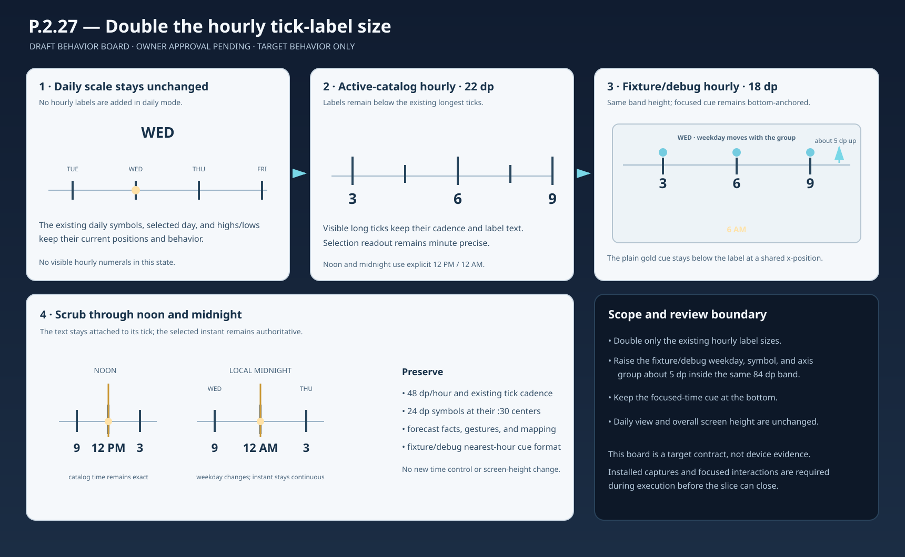

# P.2.27 — Hour label size behavior board

**Review state:** DRAFT — product-owner approval pending.

## Goal

Double the rendered size of the existing hourly long-tick labels on both timeline surfaces, preserving their meaning and interaction. The active-catalog labels change from 11 dp to 22 dp; fixture/debug labels change from 9 dp to 18 dp.

## Behavior contract

| State or event | Required behavior |
| --- | --- |
| Daily scale | Keep the existing daily timeline appearance. Do not show hourly labels. |
| Active-catalog hourly scale | Keep labels below each visible longest tick at 22 dp: `3`, `6`, `9`, with `12 AM` and `12 PM` at midnight and noon. Preserve the existing three-hour label cadence and leave intervening ticks blank. |
| Fixture/debug hourly scale | Use the same label content and cadence at 18 dp. Within the existing 84 dp timeline band, move the weekday, symbol row, and axis/labels upward about 5 dp as one group; keep the focused-time cue anchored at the bottom and preserve overall screen height. |
| Scrub | Labels stay centered on their ticks and travel with the timeline. Selection remains authoritative. The active-catalog cue stays minute precise; the fixture/debug cue keeps its nearest whole-hour source-sample format during sub-hour scrubbing. |
| Cross noon or midnight | Keep `12 PM` and `12 AM` distinct at their corresponding longest ticks. At local midnight, the weekday changes while the selected instant remains continuous. |

## Flow and states

The companion SVG/PNG board shows unchanged daily mode, hourly label sizing on both surfaces, the fixture/debug band arrangement when the 6 AM label and focused cue share an x-position, and the noon/midnight label forms. These diagrams communicate the target contract; they are not installed acceptance evidence.

## Invariants and boundaries

- Preserve horizontal tick and symbol positions, longest-tick cadence, 48 dp/hour spacing, 24 dp symbols, and `:30` symbol alignment.
- Preserve weather mapping, forecast values, selected-time authority, gesture behavior, and the fixture/debug nearest-hour source cue.
- Keep the fixture/debug band at 84 dp and keep the focused-time cue at its existing bottom anchor.
- Do not change daily artwork, screen height, forecast facts, or the surrounding experience.
- Broad TalkBack, RTL, and system/environment acceptance remains outside this visual slice.

## Proposed acceptance states

1. Active-catalog hourly view: `3`, `6`, and `9` are plainly readable at 22 dp; `12 AM` and `12 PM` fit below their long ticks.
2. Fixture/debug hourly view: the same labels are plainly readable at 18 dp. Weekday, symbols, axis, and labels are about 5 dp higher within the same band; a focused cue at the same x-position stays bottom-anchored and does not collide with its label.
3. Scrub across noon and local midnight: labels remain attached to ticks and selection remains stable; noon/midnight wording remains explicit.
4. Daily scale reference: no hourly labels appear.

## Board artifact

