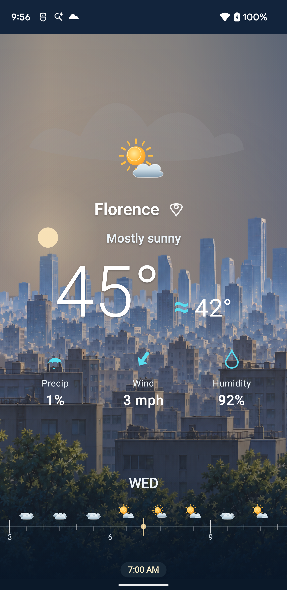
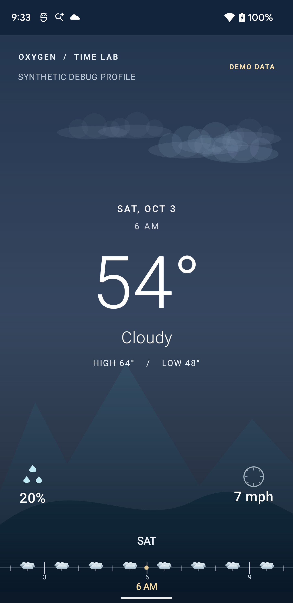
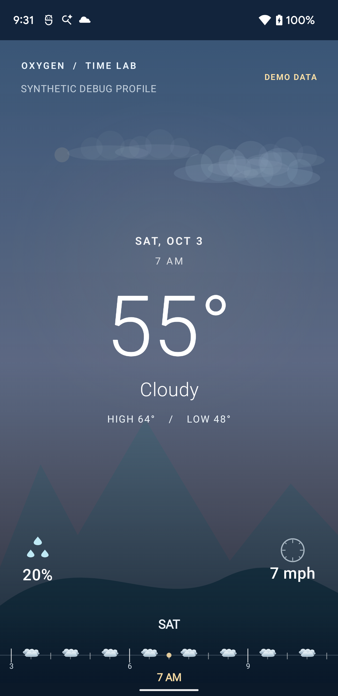
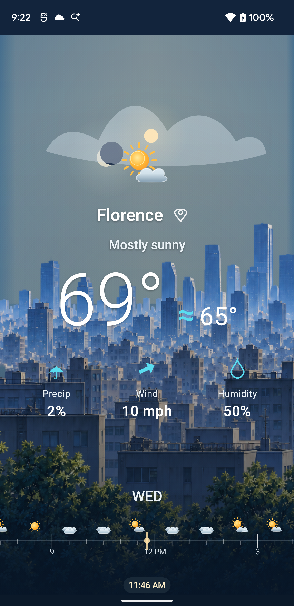
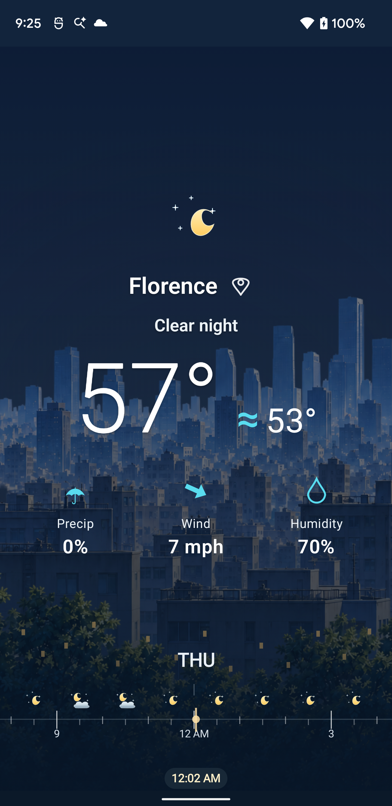
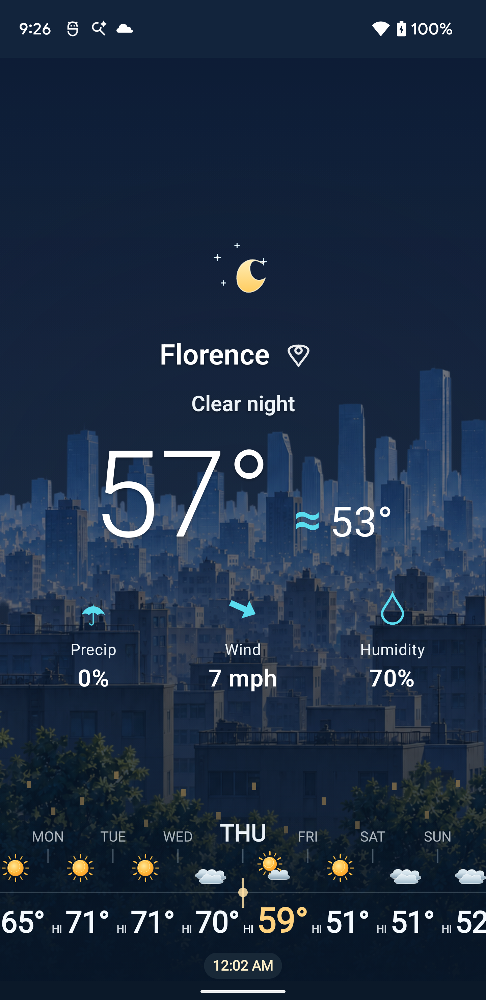
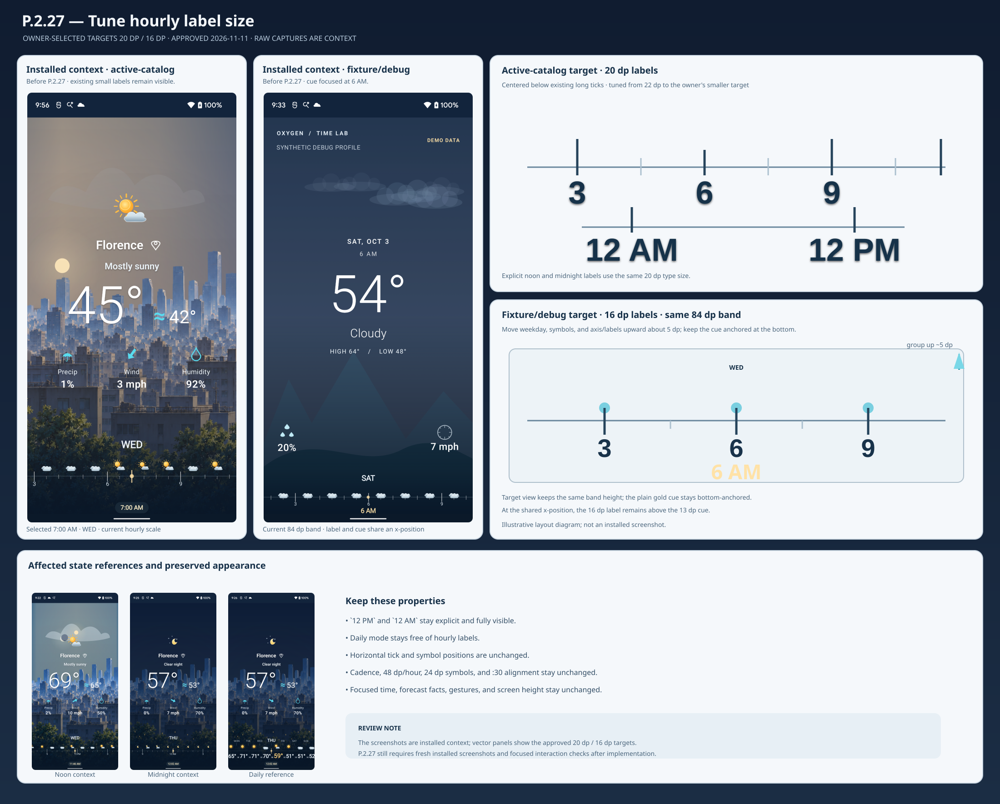

# P.2.27 — Hour label size UI artwork board

**Review state:** APPROVED — product owner selected the revised 20 dp / 16 dp targets on 2026-11-11.

## Visual objective

Increase the long-tick labels for readability, with the owner-selected targets set to 20 dp on the active-catalog timeline and 16 dp on fixture/debug after reviewing the initial enlarged appearance. Keep each label centered immediately below its existing longest tick. On fixture/debug, move the weekday, symbol row, and axis/labels upward about 5 dp inside the current 84 dp band so the focused-time cue can remain at the bottom without increasing screen height.

## Installed screen context

These unmodified captures show the current installed appearance before this slice. They provide context for the affected states; the labels shown in them are still the current small sizes. They are not P.2.27 acceptance evidence.

| State | Capture |
| --- | --- |
| Active-catalog hourly, selected 7:00 AM |  |
| Fixture/debug hourly, focused cue at 6 AM |  |
| Fixture/debug hourly, selected 7 AM |  |
| Active-catalog noon (`12 PM`) |  |
| Active-catalog midnight (`12 AM`) |  |
| Active-catalog daily reference |  |

## Proposed appearance

See the companion SVG/PNG. It pairs those installed context captures with vector target diagrams. The target diagrams use the revised owner-selected dp sizes and show the fixture/debug layout direction, including the same-x 6 AM label and cue. They are illustrative board artwork, not modified screenshots or installed evidence.

- Active-catalog labels: 20 dp (about 70 device pixels at the captured Pixel 3 XL density).
- Fixture/debug labels: 16 dp (about 56 device pixels at the captured Pixel 3 XL density).
- Fixture/debug weekday, symbols, axis, and labels: move upward about 5 dp (about 18 device pixels) as one group within the existing 84 dp band.
- Fixture/debug focused-time cue: retain its current 13 dp size and bottom anchor.
- Keep `12 AM` and `12 PM` legible and fully visible at their corresponding long ticks.
- Keep daily mode free of hourly labels.

## Review boundary

This board governs the label sizes and the owner-selected fixture/debug same-band fit adjustment only. Preserve horizontal tick/symbol positions, tick cadence, 48 dp/hour spacing, 24 dp symbols, `:30` alignment, selection, focused-time formatting, forecast values, gestures, and overall screen height. The source screenshots are prior installed context; slice acceptance still requires fresh installed hourly captures from both surfaces, focused interaction outcomes, and a daily reference.

## Board artifact

