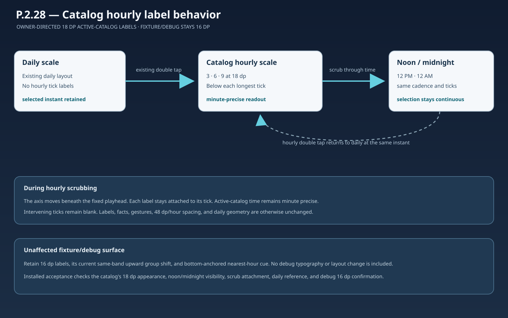

# P.2.28 — Catalog hourly label size behavior board

**Review state:** APPROVED — the product owner authorized 18 dp active-catalog labels and retained 16 dp fixture/debug labels on 2026-11-11. This board records that bounded behavior and acceptance contract.

## Objective and boundary

Change only the active-catalog hourly long-tick label paint size from 20 dp to 18 dp. Keep the existing 16 dp fixture/debug labels and their same-band layout. Keep the catalog label text, three-hour cadence, below-tick placement, selection/readout behavior, and daily mode unchanged.

## State and transition contract

| State or event | Required behavior |
| --- | --- |
| Active-catalog daily mode | Keep current daily geometry and artwork; render no hourly labels. |
| Enter active-catalog hourly mode | Keep existing entry gesture and selected-time rule. Show `3`, `6`, and `9` under their visible longest ticks at 18 dp; keep intervening ticks unlabeled. |
| Hourly scrub | Labels remain centered on and move with their own ticks. The selected instant stays under the fixed playhead and the active-catalog readout follows it to the minute. |
| Cross noon or midnight | Keep `12 PM` and `12 AM` explicit and fully visible at their existing longest ticks. Midnight remains continuous in selected time and date. |
| Return to daily mode | Preserve the exact selected instant; show no hourly labels. |
| Fixture/debug surface | Retain 16 dp labels, current 84 dp band, existing approximately 5 dp upward group shift, and bottom-anchored focused cue. This surface is unchanged by P.2.28. |

## Invariants

- Preserve the existing three-local-hour cadence and blank intervening whole-hour and half-hour ticks.
- Preserve 48 dp/hour spacing, tick lengths/positions, selected-time authority, focused-time display, daily appearance, forecast facts, symbol mapping, gestures, responsiveness, and screen geometry.
- The 18 dp change applies only to the active-catalog label paint. It does not change fixture/debug typography or layout.
- Review only the installed Pixel 3 XL states named in the P.2.28 plan; broad RTL, TalkBack, and system acceptance remain outside this slice.

## Observable acceptance

On the installed Pixel 3 XL, the active-catalog `3`, `6`, and `9` labels are 18 dp, readable, centered under their longest ticks, and move with those ticks during scrubbing. The `12 AM` and `12 PM` strings remain fully visible. The minute-specific readout follows the selected instant. Daily mode remains label-free. A fixture/debug hourly confirmation remains at 16 dp. Actual screenshots and selected-time observations are recorded in cycle 129 evidence.

## Board artifact

