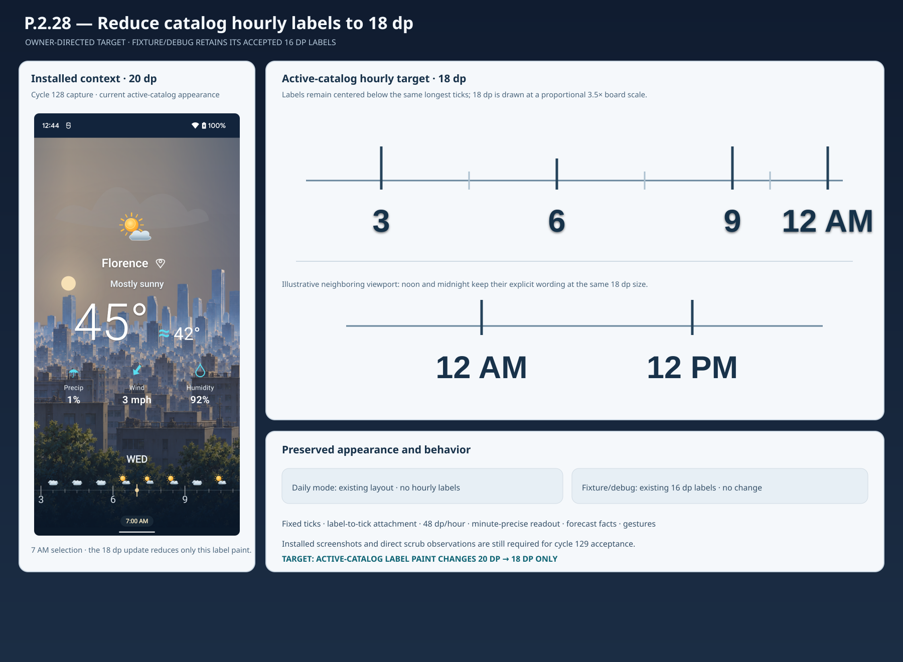

# P.2.28 — Catalog hourly label size UI artwork board

**Review state:** APPROVED — the product owner authorized 18 dp active-catalog hourly labels and retained the previously accepted 16 dp fixture/debug labels on 2026-11-11. The UI target below is limited to that size adjustment.

## Visual objective

Reduce active-catalog labels `3`, `6`, and `9` from 20 dp to 18 dp. Keep every label centered immediately below its existing longest hourly tick. Keep `12 AM` and `12 PM` at the same 18 dp size and below their existing ticks. Do not alter the fixture/debug surface, current daily artwork, screen dimensions, or timeline geometry.

## Affected and preserved states

| State | Target appearance |
| --- | --- |
| Active-catalog hourly | 18 dp labels centered below existing longest ticks; visible selected weekday, minute-specific readout, and forecast facts remain as shown in the installed context capture. |
| Noon and midnight | `12 PM` and `12 AM` remain explicit and fully visible below their current ticks. |
| Active-catalog daily | Existing daily timeline artwork remains unchanged and contains no hourly labels. |
| Fixture/debug hourly | Existing 16 dp labels and same-band layout remain unchanged. |

## Board rendering

The left panel is a prior installed Pixel 3 XL capture at 20 dp, included as current-state context. The right panel is the 18 dp target diagram. Its text sizes are drawn proportionally at 3.5 board pixels per dp; the installed app must still be checked at the reference viewport. The context capture is stored as `P.2.28-active-catalog-20dp-context.png`. This board is art direction, not acceptance evidence.

## Constraints

- Preserve tick cadence, tick and symbol positions, 48 dp/hour spacing, label alignment, selected-time behavior, forecast facts, gesture ownership, daily geometry, and overall screen dimensions.
- Do not shrink the fixture/debug labels or revise the approved 5 dp same-band layout adjustment from P.2.27.
- The 18 dp change applies only to the active-catalog label paint.

## Board artifact

