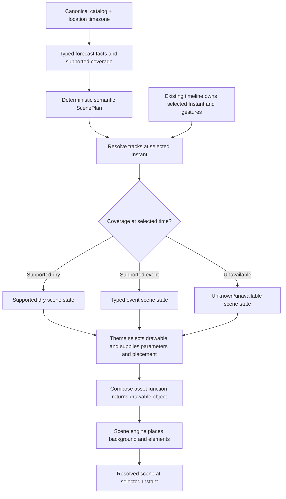

# SG.0 proposal review board — approved

**Visual review sheet:** [SG.0 proposal-review behavior board](SG.0-proposal-review-behavior-board.png) ([editable SVG](SG.0-proposal-review-behavior-board.svg)). The sheet summarizes this contract for review; this Markdown file records its full wording and approval scope.

**Status:** Product-owner approved the complete board on 2026-10-30 after reviewing the visual sheet in `feh` on display `:0`. Storyboards A–D had been approved earlier that day.
**Approval scope:** The approval covers the behavior flow, storyboards A–D, the proposed type/ownership split as SG.0 review direction, and the disposition of details below. It does not approve final UI artwork, interface layout, the complete specification, or application implementation.
**Purpose:** Review the proposed Scene Generation specification as the source of truth for bounded scene-engine roadmap slices.
**Boundary:** Documentation and behavior-contract review only. The scene engine includes a Compose asset library: functions create drawable objects, and theme parameters place them. Initial functions may draw simple placeholders. A separate UI roadmap owns final UI art direction, interface layout, and visual polish.

**Owner-provided architecture direction:** There is no existing asset pack. The intended library contains reusable drawing functions for weather and scene elements (for example, sun, partly cloudy, background, cumulus cloud, and sleet). The scene engine chooses and places their returned objects according to the theme and supported forecast state. Asset coverage should grow across globally relevant event families without city-specific code.

## Review flow

## Storyboard A — Scrubbing through an event

| Selected time | Input coverage | Scene result | Invariant |
|---|---|---|---|
| 10:30 | Supported dry | Dry placeholder | A supported dry state is explicit in the input. |
| 11:30 | Supported rain | Rain placeholder | Event timing follows the supported interval. |
| 13:30 | Unavailable | Unknown placeholder/state | Missing data never looks affirmatively dry. |
| 14:30 | Supported dry | Dry placeholder | Rain ends only at the supported boundary. |

## Storyboard B — Independent weather and light tracks

Rain remains active over one supported interval while the theme moves from day through dusk to night. The theme may swap its light-phase placeholder; the rain interval and selected forecast time remain unchanged.

## Storyboard C — Theme independence

The same `ScenePlan` and selected instant are composed in two themes. Their backgrounds, layer placement, and ordering may differ. Their event timing and forecast meaning must match.

## Storyboard D — Reduced motion

Animated mode transitions between applicable scene states. Static/reduced-motion mode shows the state resolved at the same selected instant. Neither mode changes forecast facts or takes ownership of timeline gestures.

## Approved decisions and later-slice details

1. The `ScenePlan`, `ThemeDefinition`, `ResolvedScene`, and renderer distinction is approved as direction for the SG.0 contract review; exact implementation types remain subject to source reconciliation.
2. The scene engine owns the Compose drawable-function library and placement according to theme parameters. The separate UI roadmap owns final art direction and interface design.
3. Storyboards A–D preserve the intended dry, event, unavailable, day/night, theme-variation, and reduced-motion behavior.
4. The visual treatment for unavailable coverage, exact transition rules, and missing-theme-asset fallback remain for later bounded SG slices and their own boards.

This approved board is design input for SG.0 review only. It is not installed acceptance evidence and does not authorize application implementation or claim final artwork approval.
