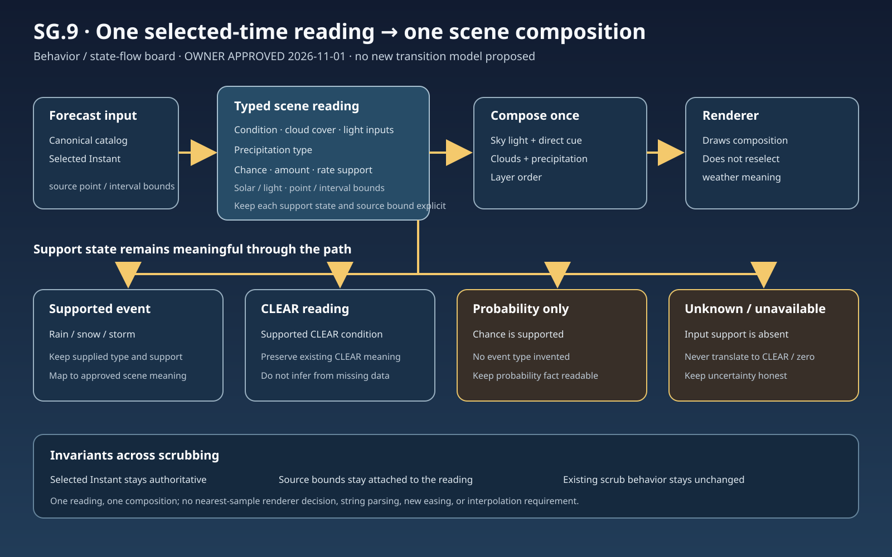

# SG.9 typed scene and composition contract — draft for owner review

Status: **APPROVED by product owner — 2026-11-01**

## Visual flow

The flow is: selected catalog and `Instant` → one typed, support-aware reading → one first-theme composition → renderer draws that composition.

## Agreement represented in the flow

- The selected `Instant` is authoritative. Keep its value and source point/interval bounds stable while scrubbing; do not substitute a renderer-owned nearest-sample weather choice.
- Keep support distinct for precipitation chance, amount, and rate. Missing support remains unknown; do not turn it into `CLEAR` or a zero value.
- Keep supported categorical condition and cloud-cover inputs typed through composition. Do not use display strings as semantic inputs.
- Probability-only and unknown readings remain distinct from supported precipitation events and from `CLEAR` readings.
- A point input and an interval input retain their own bounds in the reading. Composition may visualize the supported reading but must not invent a more precise event time.
- Preserve the existing independent priorities for combined categories: sky condition uses `STORM`, `RAIN`, `CLOUDY`, `PARTLY_CLOUDY`, `CLEAR`, then `SNOW`; precipitation depiction uses `STORM`, `SNOW`, then `RAIN`. Do not merge these into one priority order.
- A supplied non-empty categorical condition governs its visual event. For a carried condition, a uniquely positive rain or snowfall interval takes precedence; otherwise a carried rain or snow condition may cue that event. With no usable categorical condition, cue rain or snow only when exactly one corresponding amount interval is positive. Chance and rate alone never create event art. A zero amount does not establish `CLEAR`.
- Composition resolves shared sky light, direct cue visibility, clouds, precipitation, and layer order in one place. The renderer consumes those resolved choices.
- The SG.4a cloud upper-third placement rule remains in force. SG.4 rain/snow appearance and existing `CLEAR`, storm, day/night, forecast text, and timeline behavior retain their approved meanings.
- This board adds no provider fields, catalog/replay schema changes, weather families, or theme artwork. Non-catalog compatibility routes continue to use their existing inputs.
- Scrubbing continues to follow the current selected-time behavior. This contract does not prescribe new interpolation, easing, or transition timing.

## Review / acceptance intent

For `CLEAR`, rain, snow, storm, probability-only, and unknown readings (including applicable day/night states), verify the path from selected instant and source bounds through the typed reading and composition to the rendered scene. Before/after comparisons should preserve the approved visual meaning and readable forecast facts. During scrub, selected time and source bounds remain stable and directly affected gesture/readability behavior remains intact.

The implementation review should identify any remaining non-catalog or legacy route separately; it must not claim universal migration if one remains.

## Approval record

Product owner approved this behavior board on 2026-11-01. Approval covers the typed reading and composition boundary shown above, distinct evidence/support and source bounds, preservation of current selected-time scrubbing behavior without a new interpolation or transition requirement, and the independent sky/precipitation priorities and evidence rules recorded above. It does not itself activate implementation.
